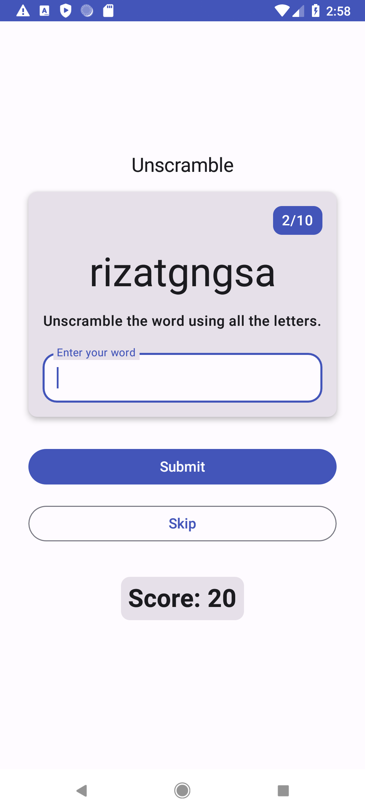
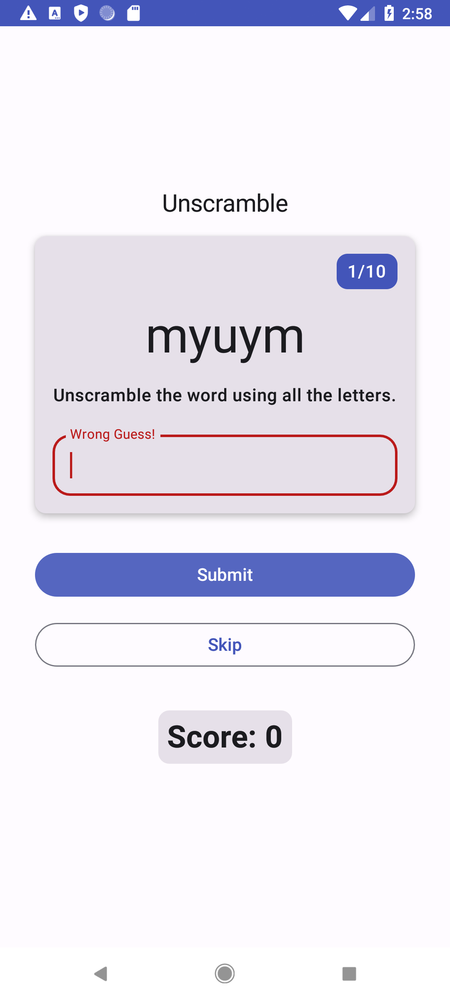
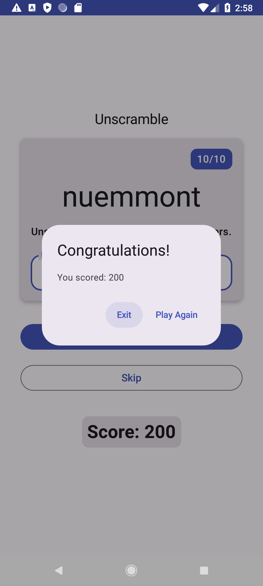

# Unscramble: ViewModel y estado en Compose

Ejercicio del curso **CC3087 · Programación de Plataformas Móviles**.

**Codelab elegido:** [ViewModel y State en Compose](https://developer.android.com/codelabs/basic-android-kotlin-compose-viewmodel-and-state?hl=es-419). Se parte de la rama `starter` del [proyecto oficial de Google](https://github.com/google-developer-training/basic-android-kotlin-compose-training-unscramble/tree/starter).

## Qué se construyó

Se completó Unscramble, un juego de palabras en inglés con una interfaz hecha en Kotlin y Jetpack Compose. En cada partida aparecen **10 palabras diferentes** con las letras mezcladas. Un acierto suma **20 puntos**; una respuesta incorrecta muestra un error y permite reintentar. **Skip** cambia de palabra sin sumar puntos. Al terminar se muestra la puntuación final y se puede volver a jugar o salir.

La pantalla inicial del proyecto tenía una palabra fija y botones sin acciones. Ahora la palabra, el contador, los puntos, el mensaje de error y el diálogo final dependen del estado del juego.

## Conceptos practicados y cambios

- **Separación de responsabilidades:** `GameScreen` dibuja la interfaz; `GameViewModel` administra las reglas; `WordsData` contiene el vocabulario y las constantes.
- **Estado inmutable:** `GameUiState` agrupa palabra mezclada, contador, puntuación, error y fin de partida. Cada cambio crea una copia del estado.
- **StateFlow y encapsulación:** el ViewModel modifica un `MutableStateFlow` privado y expone un `StateFlow` de solo lectura. Compose lo observa con `collectAsStateWithLifecycle()`.
- **Flujo unidireccional:** el estado llega a los componentes y los eventos de escribir, enviar, omitir o reiniciar vuelven al ViewModel mediante callbacks.
- **Ciclo de vida:** `viewModel()` conserva la partida y el texto pendiente cuando se recrea la actividad, como ocurre al rotar el dispositivo. Esto no implica guardar una partida después de cerrar el proceso.

| Archivo | Responsabilidad |
| --- | --- |
| `app/src/main/java/com/example/unscramble/ui/GameUiState.kt` | Datos inmutables de la pantalla. |
| `app/src/main/java/com/example/unscramble/ui/GameViewModel.kt` | Selección sin repeticiones, mezcla, validación, puntos y reinicio. |
| `app/src/main/java/com/example/unscramble/ui/GameScreen.kt` | Interfaz, entrada, botones y diálogo final. |
| `app/src/main/java/com/example/unscramble/data/WordsData.kt` | Vocabulario original, diez rondas y veinte puntos por acierto. |

Se completaron las etapas del codelab: agregar ViewModel y estado, mostrar palabras aleatorias, conectar la interfaz con el modelo, validar respuestas, omitir palabras, finalizar y reiniciar la partida.

## Problemas resueltos

- **Perder la partida al recrear la pantalla:** se movieron los datos y la lógica al ViewModel para conservar la misma instancia durante cambios de configuración.
- **Palabras repetidas:** se elige al azar entre las palabras que todavía no se usaron. La mezcla debe ser distinta de la palabra original.
- **Límite de la partida:** la décima respuesta u omisión cierra el juego sin crear una ronda 11. Después del final, el modelo ignora nuevas acciones.
- **Reinicio incompleto:** reiniciar limpia puntos, palabras usadas, error e intento pendiente.
- **SDK faltante:** se instalaron Android SDK Platform 35 y Build-Tools 35.0.0. Ante la espera del instalador automático, se descargaron los paquetes oficiales y se verificaron sus sumas SHA-1 antes de instalarlos.
- **Versiones del ejemplo:** se conservaron Gradle 8.12, AGP 8.8.0 y Kotlin 2.1.0 del código inicial. Las dependencias Lifecycle se alinearon en 2.8.7. Para compilar se usó JDK 21 en lugar del JDK 25 predeterminado del equipo.

Se mantiene la comparación sin distinguir mayúsculas del codelab y se añade tolerancia a espacios al principio o al final.

## Cómo abrir y ejecutar

1. Clonar el repositorio y abrir su carpeta en Android Studio:

   ```bash
   git clone https://github.com/CurlyKev/codelab-unscramble-viewmodel.git
   ```

2. Configurar un **Gradle JDK 17 o 21**. La verificación local utilizó JDK 21.
3. Tener instalado **Android SDK Platform 35** y permitir que Gradle descargue las dependencias. `local.properties` se genera localmente y no se publica.
4. Sincronizar Gradle y ejecutar el módulo `app` en un emulador o dispositivo con **Android 7.0 / API 24 o superior**.
5. Escribir la palabra original y pulsar **Submit**, o la acción **Done** del teclado. Usar **Skip** para omitirla.

En Windows, los comandos de terminal se ejecutan con `gradlew.bat`; en macOS/Linux, con `./gradlew`.

## Verificación

Comprobaciones locales realizadas el **15 de noviembre de 2026**, con JDK 21 y el emulador **Medium Phone, Android 8.1 / API 27**:

| Comprobación | Resultado |
| --- | --- |
| `:app:assembleDebug` | APK compilado correctamente. |
| `:app:testDebugUnitTest` | 9 pruebas aprobadas, 0 fallos. |
| `:app:lintDebug` | 0 errores; 10 advertencias (9 actualizaciones de dependencias y 1 etiqueta redundante). |
| `:app:connectedDebugAndroidTest` | 4 pruebas de interfaz aprobadas, 0 fallos. |

Las pruebas unitarias verifican inicio, mezcla, respuestas vacías e incorrectas, mayúsculas y espacios, puntuación, omisión, diez palabras sin repetir, fin de partida y reinicio. Las pruebas de interfaz verifican los botones, la acción Done del teclado, el mensaje de error, el diálogo con 200 puntos y Play Again. También rotan la actividad y la recrean, comprobando que se conservan el mismo ViewModel, la palabra, el contador, los puntos y el texto pendiente.

Para repetir la verificación, iniciar un emulador o conectar un dispositivo y ejecutar:

```bash
./gradlew :app:assembleDebug :app:testDebugUnitTest :app:lintDebug :app:connectedDebugAndroidTest
```

El [workflow de GitHub Actions](.github/workflows/main.yml) ejecuta compilación, pruebas unitarias y lint en cada push a `main` o pull request. Las cuatro pruebas de interfaz se ejecutaron localmente en el emulador; el workflow no inicia un emulador.

## Capturas de la app funcionando

Capturas reales obtenidas del emulador durante las pruebas de interfaz.

| Acierto y avance | Respuesta incorrecta | Partida terminada |
| :---: | :---: | :---: |
|  |  |  |


## Autoría y licencia

Repositorio de **CurlyKev**. Implementación, documentación y comprobaciones preparadas con asistencia de IA.

El código inicial pertenece a **The Android Open Source Project**. Se conservan sus avisos de copyright y la licencia [Apache 2.0](LICENSE).
